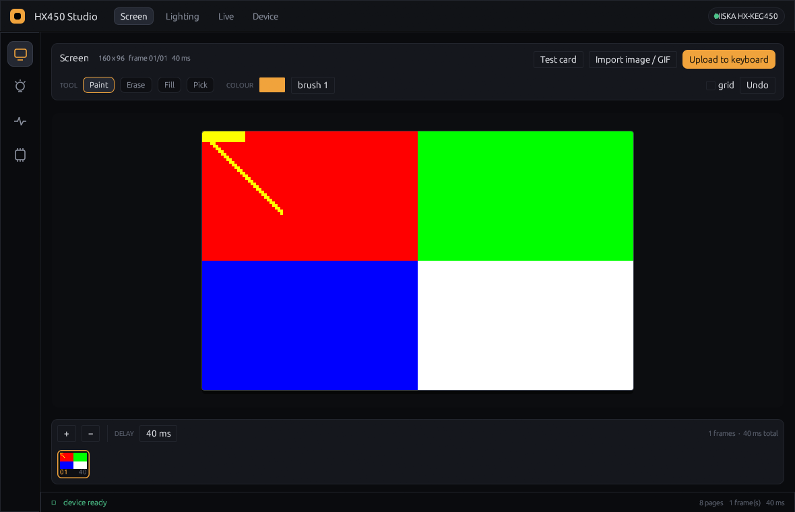
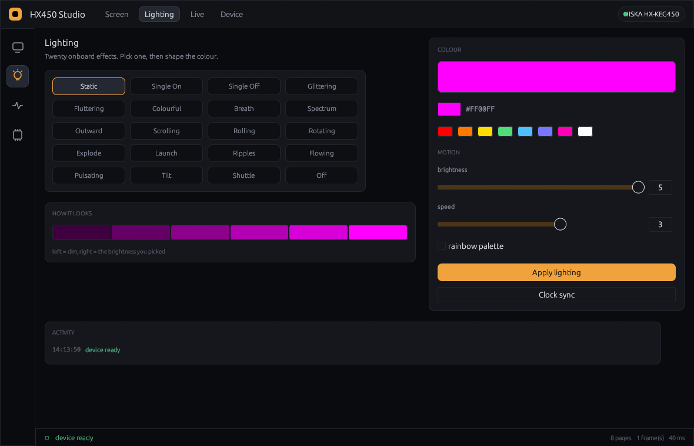
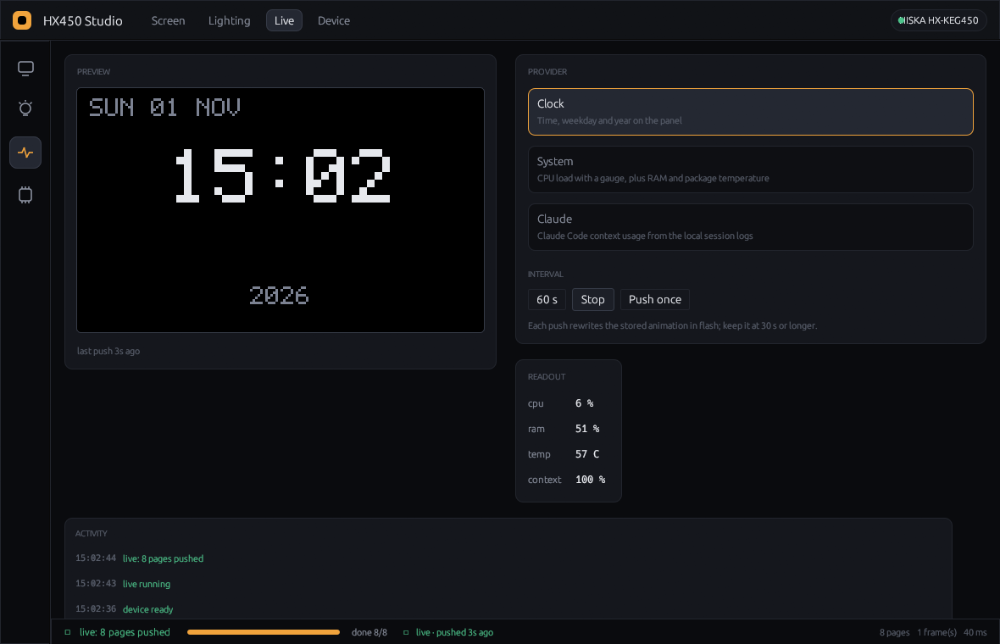
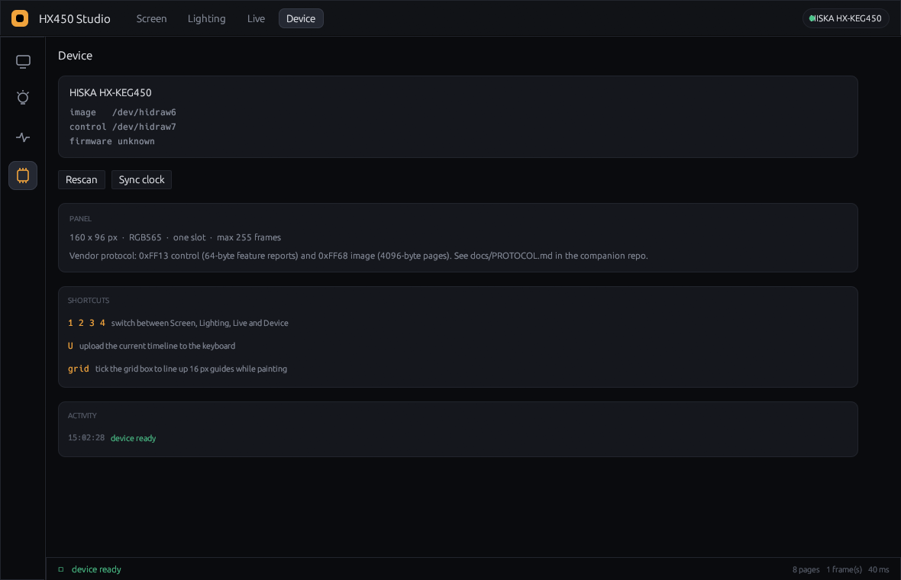

# HX450 Studio

A desktop studio for the **HISKA HX-KEG450** keyboard's 160×96 LCD and its RGB
lighting — written in Rust with [egui](https://github.com/emilk/egui), drawn on
the GPU, shipped as a single binary. No Windows, no vendor tool, no VM.



The keyboard speaks a private HID protocol that only the vendor's Windows app
understood. That protocol was reverse-engineered and is documented in the
companion repo, [`hiska-keg450-lcd`](https://github.com/securityvisions/hiska-keg450-lcd);
this app is the friendly front end for it.

## Views

| | |
|---|---|
|  | **Screen** — paint on the panel with a brush/eraser/fill, import a PNG or an animated GIF, tune per-frame delays on the timeline, then upload. |
|  | **Lighting** — all twenty onboard effects, colour picker with presets, brightness and speed. |
|  | **Live** — clock, system load or Claude Code context usage, re-rendered and pushed on an interval. |
|  | **Device** — hidraw nodes, panel facts, clock sync, shortcuts. |

## Features

- **Timeline editor** — frames, per-frame delay, thumbnails, undo, grid guides.
  Import a GIF and every frame arrives on the timeline, ready to trim.
- **WYSIWYG preview** — the canvas is the panel: 1:1 pixels scaled with nearest
  sampling, so what you draw is what the RGB565 panel shows.
- **All 20 lighting effects** — solid colour or the rainbow palette, brightness
  and speed 0–5, applied straight to the keyboard.
- **Live providers** — a 5×7 bitmap font renders clock, CPU/RAM/temperature and
  Claude Code context usage onto the panel without a browser or a font stack.
- **Non-blocking** — every HID call runs on a worker thread; a 1 700-page upload
  never freezes the window, and progress streams into the status bar.
- **Honest about the hardware** — the app refuses live intervals under 10 s and
  warns below 30 s, because each push rewrites the screen image in flash.

## Requirements

- Linux with `hidraw`, and the keyboard on the **USB-C cable** (the panel is
  disabled over 2.4 GHz and Bluetooth).
- Rust **1.88+** to build, `libudev` at runtime.
- The udev rule from the companion repo so your user can open the device:

```bash
git clone https://github.com/securityvisions/hiska-keg450-lcd.git
sudo install -m644 hiska-keg450-lcd/udev/99-hiska-keg450.rules /etc/udev/rules.d/
sudo udevadm control --reload-rules && sudo udevadm trigger --subsystem-match=hidraw
sudo usermod -aG input "$USER"   # log out and back in
```

## Build and run

```bash
cargo build --release
./target/release/hx450-studio
```

The status bar and the device chip in the top-right show whether the keyboard
was found. Click the chip to rescan.

## Using it

1. **Screen** — draw, or `Import image / GIF`. Use `+` / `−` on the timeline to
   duplicate or delete frames, set the delay, then **Upload to keyboard**
   (a 225-frame animation takes about four minutes).
2. **Lighting** — pick an effect, choose a colour, hit **Apply lighting**. Tick
   *rainbow palette* to ignore the colour and use the effect's own rainbow.
3. **Live** — choose a provider, set the interval (30 s or more), press
   **Start**. **Push once** sends a single frame.

   The clock provider ignores the interval for scheduling and aligns itself to
   the **next minute boundary** (+1.2 s), so the panel flips within about a
   second of the minute changing instead of lagging behind. A failed push
   retries after 3 s (30 s after five failures), and the status bar shows a
   green `live · pushed Ns ago` or an amber `stale` indicator, so a silent
   stall is impossible to miss.

Keyboard shortcuts: `1` `2` `3` `4` switch views, `U` uploads the timeline.

## How it talks to the keyboard

| Interface | Usage page | Reports | Used for |
|---|---|---|---|
| MI_02 | `0xFF68` | in 64 B, **out 4096 B** | screen pages, one ACK per page |
| MI_03 | `0xFF13` | in/out/feature 64 B | commands and status |

Two details that cost a lot of time and are worth repeating:

- Control reports need a **65-byte** buffer (`report id 0x00` + 64 bytes), even
  though the descriptor is unnumbered; 64 bytes fails with `EOVERFLOW`.
- Image pages must be written as **4097 bytes** (`0x00` + page); hidraw strips
  the leading report id, and a bare 4096 loses a byte on pages starting `0x00`.

The full byte-level protocol — command table, payload layout, page arithmetic,
lighting packet, and how it was recovered with Wine + `usbmon` — lives in
[`hiska-keg450-lcd/docs/PROTOCOL.md`](https://github.com/securityvisions/hiska-keg450-lcd/blob/main/docs/PROTOCOL.md).

## Limits

- **No framebuffer.** The panel stores one animation; "live" is re-uploading a
  frame, ~1.2 s each. Refresh intervals of 30–60 s keep flash wear reasonable.
- **Wired only**, as above.
- **RGB565** means 5/6/5 bits per channel: smooth gradients will band.
- **One slot** — uploading replaces whatever is stored.

## Prior work and credits

- The HID protocol was recovered in
  [`hiska-keg450-lcd`](https://github.com/securityvisions/hiska-keg450-lcd)
  (Python CLI + full protocol notes).
- The visual language here — dark surfaces, hairline borders, amber accent,
  compact rows, status bar — is inspired by
  [**Maia**](https://github.com/yappologistic/Maia), a Rust/egui file manager.
  This project is unaffiliated with Maia; it just borrows the taste.
- Built with [`eframe`/`egui`](https://github.com/emilk/egui),
  [`hidapi`](https://github.com/ruabmbua/hidapi-rs), `image`, `rfd`, `sysinfo`.

## License

[MIT](LICENSE). Not affiliated with HISKA. Use it on hardware you own.
